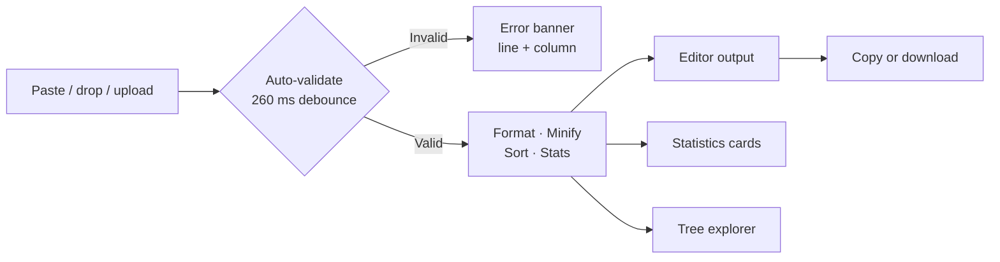

# JSONify

[](https://react.dev)
[](https://www.typescriptlang.org)
[](https://vite.dev)
[](https://tailwindcss.com)
[](LICENSE)
[](https://jsonify-tool.vercel.app)

A fast, private JSON workspace that runs entirely in your browser. Paste, drop, or upload JSON to format, minify, validate, explore, compare, convert, and generate examples. Nothing is uploaded to a server, and your JSON is never stored.

**[Open the live app →](https://jsonify-tool.vercel.app)**

**Jump to:** [Features](#features) · [Tools](#tools) · [Try it](#try-it-in-30-seconds) · [How it works](#how-it-works) · [Getting Started](#getting-started) · [Shortcuts](#keyboard-shortcuts) · [Structure](#project-structure) · [FAQ](#faq)

## Features

| | Capability | What it does |
| --- | --- | --- |
| Format | **Beautify** | Indent with 2, 4, or 8 spaces, or a real tab |
| Format | **Minify** | Strip whitespace and show the size reduction |
| Validate | **Live validation** | Line- and column-aware errors with fix suggestions |
| Transform | **Sort keys** | Order object keys alphabetically at every level |
| Transform | **Pretty nested** | Expand or inline nested containers |
| Transform | **Array layout** | Expand arrays or keep primitive arrays compact |
| Inspect | **Statistics** | Size, characters, lines, objects, arrays, keys, depth, types, timing |
| Inspect | **Tree explorer** | Expand/collapse all with pagination for large collections |
| Compare | **Two-way diff** | Side-by-side semantic diff with added, removed, and changed markers, filters, swap, and drag and drop on both sides |
| Convert | **CSV ↔ JSON** | Convert CSV rows to JSON or flatten JSON into CSV with delimiter, header, and type-inference options |
| Generate | **Schema examples** | Generate sample documents from a JSON Schema, or infer a schema from any sample JSON and generate variations |
| Export | **Copy / download** | Formatted, minified, converted, or generated output with an editable filename |
| Import | **Files & sample** | `.json` and `.csv` up to 20 MB via picker or drag and drop, plus built-in samples |
| Experience | **Themes & shortcuts** | OS-aware light/dark mode, toasts, keyboard shortcuts, responsive layout |

## Tools

JSONify is organized into focused screens instead of one long page:

| Screen | Route | Purpose |
| --- | --- | --- |
| Formatter | `#/formatter` | Format, minify, validate, sort, inspect statistics, and explore the tree |
| Compare | `#/compare` | Diff two JSON documents side by side with drag and drop on both sides |
| Convert | `#/convert` | Convert CSV to JSON or JSON to CSV with delimiter and header controls |
| Schema | `#/schema` | Generate examples from a JSON Schema or from a sample JSON document |
| Documentation | `#/docs` | In-app reference for every control and shortcut |

## Try it in 30 seconds

Open **[jsonify-tool.vercel.app](https://jsonify-tool.vercel.app)** and use this checklist:

- [ ] Paste JSON into the input editor, drop a `.json` file on it, or press **Load sample**
- [ ] Pick an indentation style and toggle **Sort keys**, **Pretty nested**, or **Array layout**
- [ ] Press `Ctrl/Cmd + Enter` to validate, or `Ctrl/Cmd + Shift + M` to minify
- [ ] Expand nodes in the **tree explorer** and scan the **statistics** cards
- [ ] Copy the result, or edit the filename and download a `.json` file
- [ ] Open **Compare**, drop a document on each side, and review added, removed, and changed values
- [ ] Open **Convert**, load the CSV sample, then switch the delimiter and convert to JSON
- [ ] Open **Schema**, load the sample schema or a sample document, and generate 1, 3, 5, or 10 examples

## How it works



Parsing runs in a Web Worker so the interface stays responsive. If workers are unavailable, processing falls back to the main thread automatically. Compare, conversion, and schema generation use pure TypeScript modules that run locally and keep their state when you switch screens.

## Privacy

All parsing, validation, formatting, comparison, CSV conversion, and schema example generation happen locally on your device. JSON content never leaves the browser and is never written to `localStorage`. Only your theme preference is persisted.

<details>
<summary><strong>Read the full privacy model</strong></summary>

- No JSON, CSV, schema, or generated output is sent to a backend server.
- No document content is stored in `localStorage` or cookies.
- No document content is sent to analytics services.
- No third-party tracking scripts are loaded.
- Imported files are read with the browser File API.
- Downloads are generated in-browser with a Blob and object URL.
- The only persisted value is the `jsonify-theme` preference.

</details>

## Tech Stack

<details>
<summary><strong>Show stack and tooling</strong></summary>

- React 19
- TypeScript
- Vite
- Tailwind CSS 4
- CodeMirror 6 (`@uiw/react-codemirror`)
- Lucide icons
- Inter and JetBrains Mono variable fonts
- Oxlint

</details>

## Getting Started

Requires Node.js 20.19+ or 22.12+.

```bash
npm install
npm run dev
```

Open the URL shown by Vite, usually `http://localhost:5173`.

<details>
<summary><strong>Available scripts</strong></summary>

```bash
npm run dev      # Start the development server
npm run build    # Type-check and build for production
npm run lint     # Run Oxlint
npm run preview  # Preview the production build
```

</details>

## Deployment

The app is deployed on Vercel at **[jsonify-tool.vercel.app](https://jsonify-tool.vercel.app)**.

To deploy your own copy, import the repository into Vercel and use the default Vite settings:

| Setting | Value |
| --- | --- |
| Build command | `npm run build` |
| Output directory | `dist` |
| Install command | `npm install` |

## Keyboard Shortcuts

| Shortcut               | Action                          |
| ---------------------- | ------------------------------- |
| `Ctrl/Cmd + Enter`     | Validate JSON                   |
| `Ctrl/Cmd + Shift + M` | Minify and show minified output |
| `Esc`                  | Close dialogs and menus         |

Formatting shortcuts are active on the **Formatter** screen (`#/formatter`).

## Project Structure

```text
src/
  components/       UI components, panels, workspaces, and primitives
    ui/             Reusable button, tooltip, and segmented controls
  hooks/            Theme, worker, compare, converter, schema, and screen-routing hooks
  lib/json/         Pure parsing, formatting, stats, compare, CSV, schema, and file utilities
  types/            Shared TypeScript types
  workers/          Web Worker entry point
```

Formatting logic lives in `src/lib/json/core.ts` and is shared by the worker and the main-thread fallback. The other tools are pure modules: `compare.ts`, `csv.ts`, and `schema.ts`.

<details>
<summary><strong>Where to make common changes</strong></summary>

| Task | File |
| --- | --- |
| Change indentation or sorting behavior | `src/lib/json/core.ts` |
| Adjust file size limits or downloads | `src/App.tsx` and `src/lib/json/file.ts` |
| Update worker debounce or fallback logic | `src/hooks/useJsonWorker.ts` |
| Change JSON diff behavior | `src/lib/json/compare.ts` |
| Change CSV parsing or serialization | `src/lib/json/csv.ts` |
| Change schema or sample-generation behavior | `src/lib/json/schema.ts` |
| Add or rename a screen | `src/hooks/useScreen.ts`, `src/types/ui.ts`, and `src/App.tsx` |
| Restyle the workspace or theme | `src/index.css` and `src/components/` |
| Change sample content | `src/lib/json/sample.ts` |

</details>

## FAQ

<details>
<summary>Does anything leave my browser?</summary>

No. Formatting, validation, statistics, comparison, CSV conversion, schema generation, and downloads all run client-side. Only the theme preference is saved locally.

</details>

<details>
<summary>What is the maximum file size?</summary>

20 MB per file for formatter, compare, CSV, and schema inputs, whether you pick it or drag and drop it.

</details>

<details>
<summary>Why does the output pause briefly while typing?</summary>

On the Formatter screen, large inputs are sent to a Web Worker after a 260 ms debounce to keep the editor responsive. Short inputs feel immediate.

</details>

<details>
<summary>Is the minified output guaranteed smaller?</summary>

Usually, but not always. The app reports the reduction as a percentage when there is one, and still shows the minified output when there is none.

</details>

<details>
<summary>Does Compare upload either document?</summary>

No. Both documents are parsed and diffed in the browser, and the comparison state stays local until you clear it or close the tab.

</details>

<details>
<summary>Can I generate examples from a sample document instead of a schema?</summary>

Yes. Paste a JSON Schema for precise control, or paste any JSON document. If the input is not a schema, JSONify infers the structure, required fields, and common formats (emails, dates, UUIDs, URLs), then generates variations for you.

</details>

<details>
<summary>Does schema generation support references and constraints?</summary>

Yes. It supports local `$ref` values such as `#/$defs/...` and `#/definitions/...`, plus `allOf`, `oneOf`, `anyOf`, enums, formats, string and numeric limits, array bounds, and optional properties.

</details>

## License

MIT
