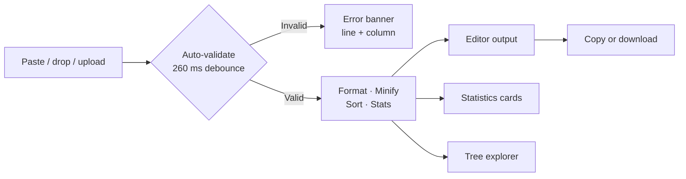

# JSON Formatter Pro

[](https://react.dev)
[](https://www.typescriptlang.org)
[](https://vite.dev)
[](https://tailwindcss.com)
[](LICENSE)

A fast, private JSON workspace that runs entirely in your browser. Paste, drop, or upload JSON to format, minify, validate, and explore it. Nothing is uploaded to a server, and your JSON is never stored.

**Jump to:** [Features](#features) · [Try it](#try-it-in-30-seconds) · [How it works](#how-it-works) · [Getting Started](#getting-started) · [Shortcuts](#keyboard-shortcuts) · [Structure](#project-structure) · [FAQ](#faq)

## Features

| | Capability | What it does |
| --- | --- | --- |
| Format | **Beautify** | Indent with 2, 4, or 8 spaces, or a real tab |
| Format | **Minify** | Strip whitespace and show the size reduction |
| Validate | **Live validation** | Line- and column-aware errors with fix suggestions |
| Transform | **Sort keys** | Order object keys alphabetically at every level |
| Transform | **Pretty nested** | Expand or inline nested containers |
| Transform | **Array layout** | Expand arrays or keep primitive arrays compact |
| Inspect | **Statistics** | Size, characters, lines, objects, arrays, keys, depth, types, timing |
| Inspect | **Tree explorer** | Expand/collapse all with pagination for large collections |
| Export | **Copy / download** | Formatted or minified output with an editable filename |
| Import | **Files & sample** | `.json` up to 20 MB via picker or drag and drop, plus a built-in sample |
| Experience | **Themes & shortcuts** | OS-aware light/dark mode, toasts, keyboard shortcuts, responsive layout |

## Try it in 30 seconds

Use this checklist the first time you open the app:

- [ ] Paste JSON into the input editor, drop a `.json` file on it, or press **Load sample**
- [ ] Pick an indentation style and toggle **Sort keys**, **Pretty nested**, or **Array layout**
- [ ] Press `Ctrl/Cmd + Enter` to validate, or `Ctrl/Cmd + Shift + M` to minify
- [ ] Expand nodes in the **tree explorer** and scan the **statistics** cards
- [ ] Copy the result, or edit the filename and download a `.json` file

## How it works



Parsing runs in a Web Worker so the interface stays responsive. If workers are unavailable, processing falls back to the main thread automatically.

## Privacy

All parsing, validation, formatting, and statistics happen locally on your device. JSON content never leaves the browser and is never written to `localStorage`. Only your theme preference is persisted.

<details>
<summary><strong>Read the full privacy model</strong></summary>

- No JSON is sent to a backend server.
- No JSON is stored in `localStorage` or cookies.
- No JSON content is sent to analytics services.
- No third-party tracking scripts are loaded.
- Imported files are read with the browser File API.
- Downloads are generated in-browser with a Blob and object URL.
- The only persisted value is the `json-formatter-pro-theme` preference.

</details>

## Tech Stack

<details>
<summary><strong>Show stack and tooling</strong></summary>

- React 19
- TypeScript
- Vite
- Tailwind CSS 4
- CodeMirror 6 (`@uiw/react-codemirror`)
- Lucide icons
- Inter and JetBrains Mono variable fonts
- Oxlint

</details>

## Getting Started

Requires Node.js 20.19+ or 22.12+.

```bash
npm install
npm run dev
```

Open the URL shown by Vite, usually `http://localhost:5173`.

<details>
<summary><strong>Available scripts</strong></summary>

```bash
npm run dev      # Start the development server
npm run build    # Type-check and build for production
npm run lint     # Run Oxlint
npm run preview  # Preview the production build
```

</details>

## Keyboard Shortcuts

| Shortcut               | Action                          |
| ---------------------- | ------------------------------- |
| `Ctrl/Cmd + Enter`     | Validate JSON                   |
| `Ctrl/Cmd + Shift + M` | Minify and show minified output |
| `Esc`                  | Close dialogs and menus         |

## Project Structure

```text
src/
  components/       UI components, panels, and primitives
    ui/             Reusable button, tooltip, and segmented controls
  hooks/            Theme and JSON worker hooks
  lib/json/         Pure parsing, formatting, stats, and file utilities
  types/            Shared TypeScript types
  workers/          Web Worker entry point
```

Formatting logic lives in `src/lib/json/core.ts` and is shared by the worker and the main-thread fallback.

<details>
<summary><strong>Where to make common changes</strong></summary>

| Task | File |
| --- | --- |
| Change indentation or sorting behavior | `src/lib/json/core.ts` |
| Adjust file size limits or downloads | `src/App.tsx` and `src/lib/json/file.ts` |
| Update worker debounce or fallback logic | `src/hooks/useJsonWorker.ts` |
| Restyle the workspace or theme | `src/index.css` and `src/components/` |
| Change sample content | `src/lib/json/sample.ts` |

</details>

## FAQ

<details>
<summary>Does anything leave my browser?</summary>

No. Formatting, validation, statistics, and downloads all run client-side. Only the theme preference is saved locally.

</details>

<details>
<summary>What is the maximum file size?</summary>

20 MB per `.json` file, whether you pick it or drag and drop it.

</details>

<details>
<summary>Why does the output pause briefly while typing?</summary>

Large inputs are sent to a Web Worker after a 260 ms debounce to keep the editor responsive. Short inputs feel immediate.

</details>

<details>
<summary>Is the minified output guaranteed smaller?</summary>

Usually, but not always. The app reports the reduction as a percentage when there is one, and still shows the minified output when there is none.

</details>

## License

MIT
